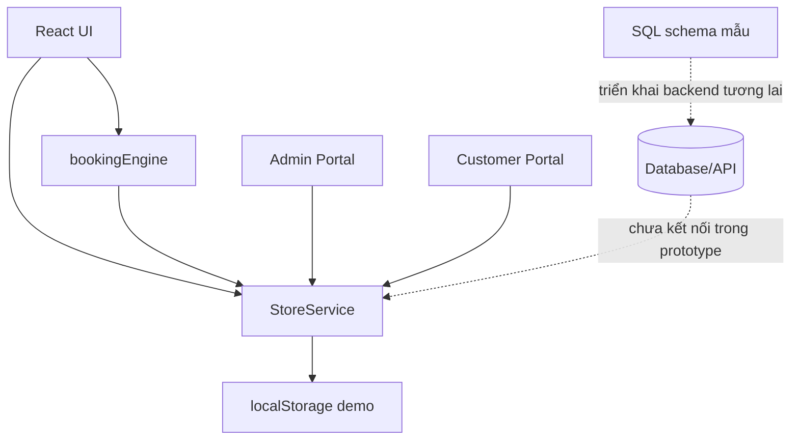
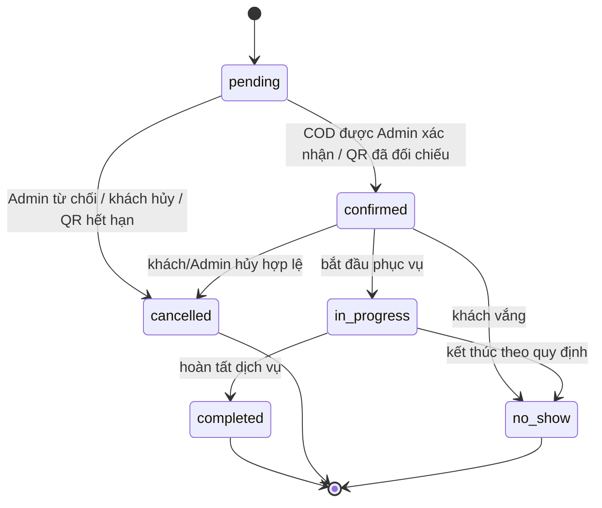

# Kiến trúc ứng dụng Pet Phết

## Luồng tổng thể

## Nguyên tắc tổ chức

- `components/customer` và `components/admin` tách rõ trải nghiệm hai vai trò.
- `components/booking` chỉ điều phối trải nghiệm đặt lịch và thanh toán; quy tắc lưu dữ liệu nằm trong `StoreService`.
- `utils/bookingEngine.ts` chịu trách nhiệm tính giá theo cân nặng, giảm giá, thời lượng và kiểm tra sức chứa.
- `StoreService` là lớp truy cập dữ liệu demo thống nhất. Khi triển khai backend, thay implementation này bằng repository/API nhưng giữ giao diện hàm nghiệp vụ để hạn chế sửa UI.
- Mọi kiểm tra quyền hiện tại trong `StoreService` chỉ phù hợp demo. Backend thực phải kiểm tra lại quyền sở hữu và role từ token/session tin cậy, không dựa vào dữ liệu do client gửi.

## Quy tắc trạng thái booking

Đơn QR chỉ được chuyển sang `confirmed` sau trạng thái thanh toán `paid`; xác nhận chuyển khoản từ khách chỉ đưa payment sang `pending_reconcile`. Đơn QR chưa thanh toán/chưa đối chiếu hết thời gian giữ chỗ sẽ chuyển `cancelled`, payment sang `failed` và nhả sức chứa.

## Data model

Các bảng nền tảng trong `database/schema.sql`: users, pets, service_categories, services, service_images, working_schedules, time_slots, bookings, payments, reviews. Pet Point và notification có thêm mô hình trong code demo và cần bổ sung/đối chiếu schema khi làm backend chính thức.
